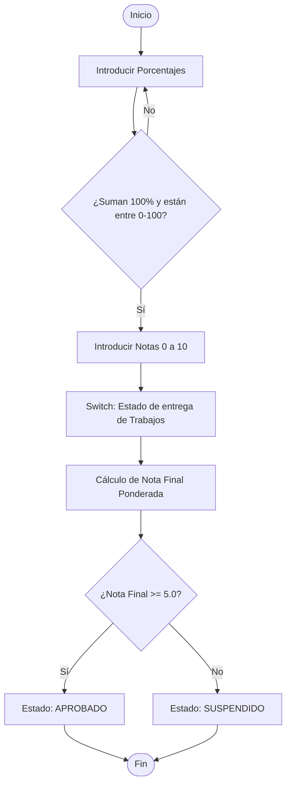

# Calculadora de Calificaciones en Go

Programa interactivo en Go para calcular la nota final ponderada de un alumno a partir de tres apartados: **Exámenes**, **Comportamiento** y **Trabajos**.

---

## Estructuras de Programación Utilizadas

El ejercicio pone en práctica los conceptos fundamentales de Go:

| Concepto | Dónde se utiliza |
| :--- | :--- |
| **`for` (Bucles)** | Repite la petición de datos hasta que los valores sean correctos (porcentajes que sumen 100 y notas entre 0 y 10). |
| **`if / else` (Condicionales)** | Valida los rangos de entrada y determina si el alumno está **Aprobado** ( $\ge 5$ ) o **Suspendido** ( $< 5$ ). |
| **`switch` (Casos)** | Modifica la nota de los trabajos según la calidad o puntualidad de entrega. |
| **`break` / `continue`** | Controla el flujo dentro de los bucles de validación. |
| **Salida interactiva** | Permite escribir `'s'` o `'S'` en cualquier momento para salir del programa. |

---

## Flujo del Programa



---

## Cómo Ejecutarlo

Abre tu terminal en la carpeta del proyecto y ejecuta:

```bash
go run main.go
```

---